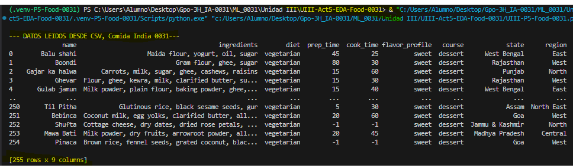
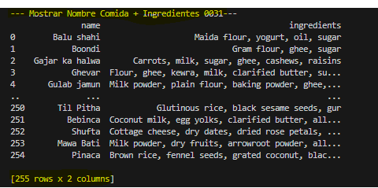
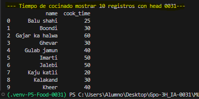
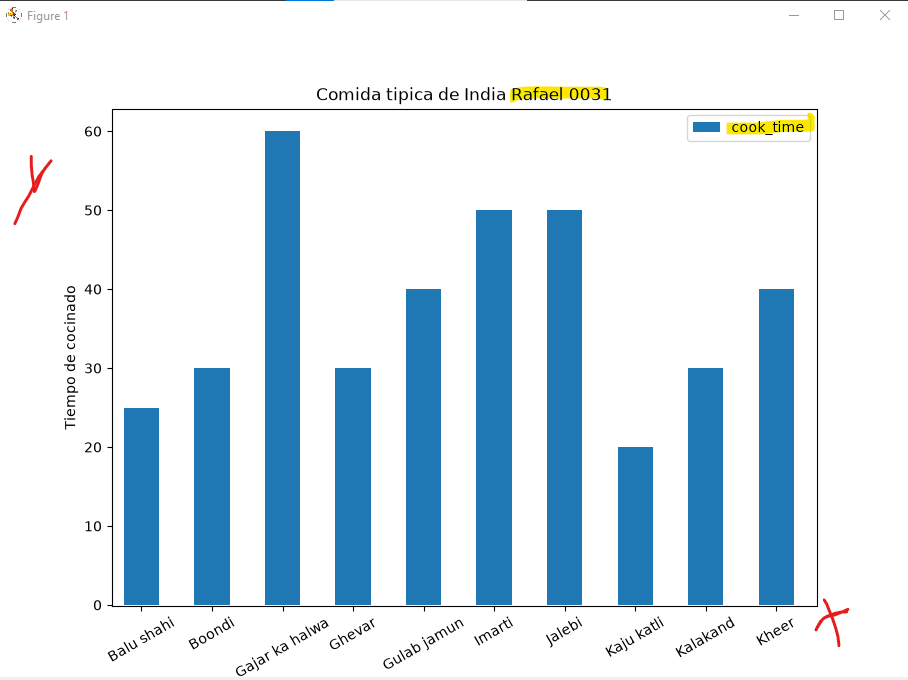
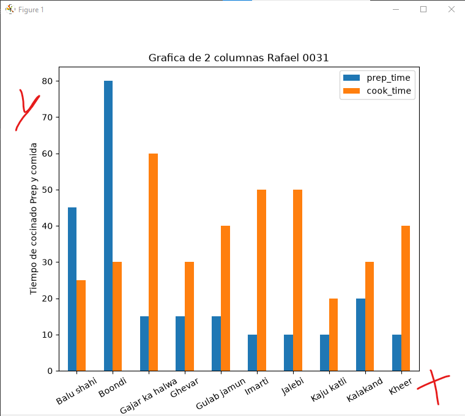
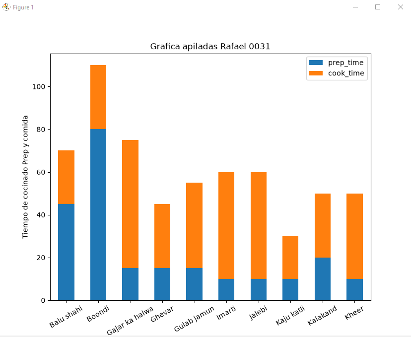

## Analisis exploratorio de datos
## Comida del pais India
## Arevalo Rafael NC:0031
### +-+- Imórtando datos del CSV comida de India 

### +-+- Mostrar Nombre Comida + Ingredientes 

### Tiempo de cocinado mostrar 10 registros con head 

## Creacion de graficos de barras 0031

## gráfica de varias columnas 

## Gradicas apiladas 
